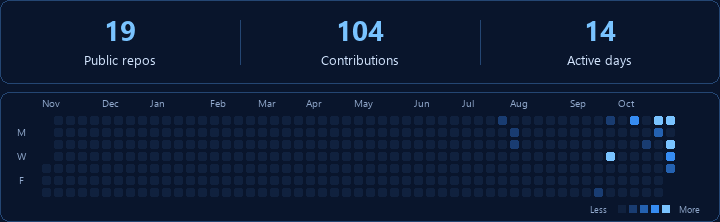

<h1>Yerkebulan Abenov</h1>

<strong>Computer Science · Software development · Open source</strong>

  

Computer Science student at <strong>Astana IT University</strong>, based in Astana, Kazakhstan. Building tools for learning and productivity. Open to <strong>internships, junior roles, and collaboration.</strong>

  
  
  
  
  
  

<h2> Featured project</h2>

<strong><a href="https://github.com/Abenovv/quiz-maker-obsidian-edition">Quiz maker for Obsidian</a></strong> Turn notes into editable quizzes and flashcards. Practice, exams, review, and JSON import.

<a href="https://github.com/Abenovv/quiz-maker-obsidian-edition/releases/latest">Download</a> · <a href="https://github.com/Abenovv/quiz-maker-obsidian-edition/blob/main/docs/guide.md">Guide</a> · <a href="https://github.com/Abenovv/quiz-maker-obsidian-edition/issues">Contribute</a>

Released · TypeScript and React · Continuing <a href="https://github.com/ECuiDev/obsidian-quiz-generator">Edward Cui's Quiz Generator</a>.

<strong>Preview and project details</strong>

<ul>
  <li>Five study modes: practice, timed practice, exam, flashcards, and review.</li>
  <li>17 question formats, from multiple choice to concept maps.</li>
  <li>Optional AI generation, manual JSON quizzes, and readable saved questions.</li>
</ul>

Published browser preview with sample questions. <a href="https://github.com/Abenovv/quiz-maker-obsidian-edition#appearance">More screens and appearance options</a>.

<h2> Languages</h2>

  
  
  
  
  
  

<!-- activity:start -->

<strong>Activity and contributions</strong>

<a href="assets/activity/activity.png" title="Open static version"><picture>
  <source media="(max-width: 480px)" srcset="assets/activity/activity-mobile.gif" />
  
</picture></a>

Year through 29 Oct 2026 · Snapshot 30 Oct 2026 · <a href="https://github.com/Abenovv">GitHub</a> · <a href="assets/activity/activity.png">Static view</a>

<!-- activity:end -->

<strong>Background &amp; highlights</strong>

<ul>
  <li><strong>Education:</strong> Bachelor's studies in Computer Science, Astana IT University · 2026–present.</li>
  <li><strong>HackAlem AI 2026:</strong> <a href="https://www.linkedin.com/feed/update/urn:li:activity:7508576576754790400/">participant, working with AI agents in a team</a>.</li>
  <li><strong>Skills:</strong> software development, front-end development, problem solving, and mentoring.</li>
</ul>

