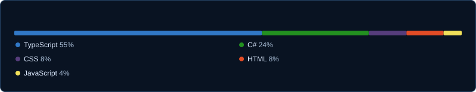
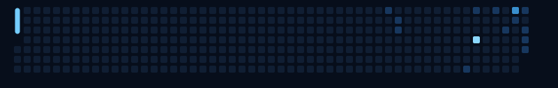
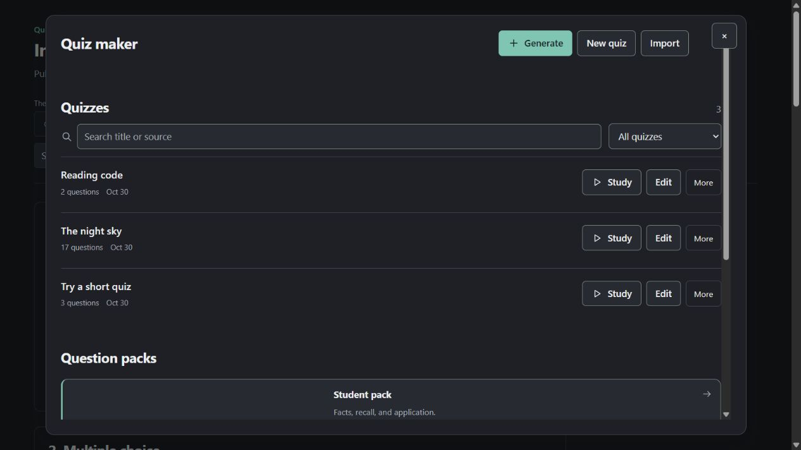

<!-- Generated by scripts/render.mjs. Profile data refreshes via GitHub Actions. -->
<picture>
  <source media="(max-width: 600px)" srcset="assets/dashboard-mobile.svg" />
  
</picture>

      

    

    

    

    
    

<strong><a href="https://github.com/Abenovv/quiz-maker-obsidian-edition">Quiz maker for Obsidian</a></strong> — turn notes into editable quizzes and flashcards. <a href="https://github.com/Abenovv/quiz-maker-obsidian-edition/releases/latest">Download</a> · <a href="https://github.com/Abenovv/quiz-maker-obsidian-edition/blob/main/docs/guide.md">Guide</a> · <a href="https://github.com/Abenovv/quiz-maker-obsidian-edition/issues">Contribute</a> TypeScript + React · Continuing <a href="https://github.com/ECuiDev/obsidian-quiz-generator">Edward Cui's Quiz Generator</a>.

<strong>Preview and project details</strong>

<ul>
  <li>Five study modes: practice, timed practice, exam, flashcards, and review.</li>
  <li>17 question formats, from multiple choice to concept maps.</li>
  <li>Optional AI generation, manual JSON quizzes, and readable saved questions.</li>
</ul>

Published browser preview with sample questions. <a href="https://github.com/Abenovv/quiz-maker-obsidian-edition#appearance">More screens and appearance options</a>.

<strong>Background &amp; highlights</strong>

<ul>
  <li><strong>Education:</strong> Bachelor's studies in Computer Science, Astana IT University · 2026–present.</li>
  <li><strong>HackAlem AI 2026:</strong> <a href="https://www.linkedin.com/feed/update/urn:li:activity:7508576576754790400/">participant, working with AI agents in a team</a>.</li>
  <li><strong>Skills:</strong> software development, front-end development, problem solving, and mentoring.</li>
</ul>

Metrics and blue snake refresh twice daily. <a href="https://github.com/Abenovv/Abenovv/actions/workflows/refresh-profile.yml">Refresh status</a> · <a href="assets/profile-data.json">Public data</a> · Built with <a href="https://github.com/Igorcbraz/GitAscii">GitAscii</a> and <a href="https://github.com/maurodesouza/profile-readme-generator">Profile Readme Generator</a>.

