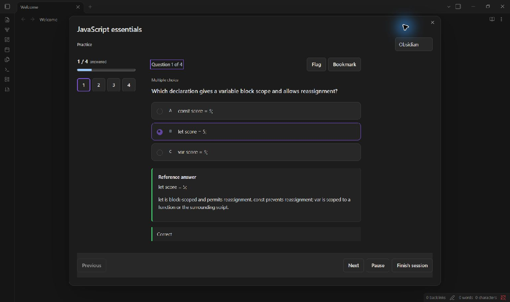

<!-- Generated from content/ and public profile data. See PROFILE-AUTOMATION.md for maintenance. -->
<h1 align="center">Yerkebulan Abenov</h1>

Computer Science student · Software developer

    

<picture><source media="(prefers-reduced-motion: reduce)" srcset="assets/intro-static.svg?v=0e628a450ccb" /></picture>

<h2>About me</h2>

I'm a Computer Science student at Astana IT University in Astana, Kazakhstan. I build study tools and web projects alongside my coursework.

<h3>Now</h3>

I'm working on <a href="https://github.com/Abenovv/quiz-maker-obsidian-edition">Quiz maker for Obsidian</a>, a plugin for studying from your own notes. I'm open to internships, junior developer roles, and open-source collaboration.

<h2>Selected work</h2>
<h3><a href="https://github.com/Abenovv/quiz-maker-obsidian-edition">Quiz maker for Obsidian</a></h3>

Turn notes into quizzes and flashcards, edit the questions, and review what you missed. Practice at your own pace or take a timed exam.

<a href="https://github.com/Abenovv/quiz-maker-obsidian-edition/releases/latest"><strong>Download</strong></a> · <a href="https://github.com/Abenovv/quiz-maker-obsidian-edition/blob/main/docs/guide.md">Read the guide</a> · <a href="https://github.com/Abenovv/quiz-maker-obsidian-edition">Explore the code</a> · <a href="https://github.com/Abenovv/quiz-maker-obsidian-edition/issues">Ideas &amp; feedback</a>

<strong>See Quiz maker in action</strong>

<ul>
  <li>Practice, timed practice, exams, flashcards, and review.</li>
  <li>17 question formats and seven study packs you can adjust.</li>
  <li>Write or import your own questions, or use optional AI generation.</li>
</ul>

<a href="https://github.com/Abenovv/quiz-maker-obsidian-edition#inside-obsidian">More views of the plugin</a> · <a href="https://github.com/Abenovv/quiz-maker-obsidian-edition/blob/main/docs/examples/javascript-essentials.json">Try a sample quiz</a>

Built with TypeScript and React. Inspired by Edward Cui's <a href="https://github.com/ECuiDev/obsidian-quiz-generator">Quiz Generator</a>.

<strong>More projects from my studies</strong>

<a href="https://github.com/Abenovv/Web-technology-5-assignment"><strong>JavaScript browser exercises</strong></a> A number-guessing game, a Kanban board with filtering and card movement, and a character form with a live preview. Coursework built with HTML, CSS, and JavaScript.

<a href="https://github.com/Abenovv/Web-technology-5-assignment">View the exercises</a>

<h2>Languages</h2>

     

<strong>Education &amp; community</strong>

<strong>Astana IT University</strong> Bachelor's studies in Computer Science · 2026–present.

<strong>HackAlem AI 2026</strong> I participated in a team working with AI agents. <a href="https://www.linkedin.com/feed/update/urn:li:activity:7508576576754790400/">Read about the event</a>.

<h2>Activity</h2>

<strong>19</strong> public repositories · <strong>121</strong> public contributions in the past year · <strong>4</strong> followers

<a href="assets/contribution-static.svg?v=9c0167efb449" title="View without animation"><picture><source media="(prefers-reduced-motion: reduce)" srcset="assets/contribution-static.svg?v=9c0167efb449" /></picture></a>

<strong>Languages across my projects</strong>

<table><thead><tr><th>Language</th><th>Share</th></tr></thead><tbody><tr><td>TypeScript</td><td>56.7%</td></tr><tr><td>C#</td><td>21.0%</td></tr><tr><td>CSS</td><td>9.5%</td></tr><tr><td>HTML</td><td>7.3%</td></tr><tr><td>JavaScript</td><td>3.7%</td></tr><tr><td>Java</td><td>1.4%</td></tr><tr><td>Shell</td><td>0.1%</td></tr><tr><td>PowerShell</td><td>0.1%</td></tr><tr><td>C</td><td>0.1%</td></tr><tr><td>Python</td><td>0.1%</td></tr></tbody></table>

<h2>Get in touch</h2>

For a role, a project, or feedback on my work, reach me by <a href="mailto:yerkebulanabenov7@gmail.com">email</a> or on <a href="https://www.linkedin.com/in/yerkebulanabenov/">LinkedIn</a>.

